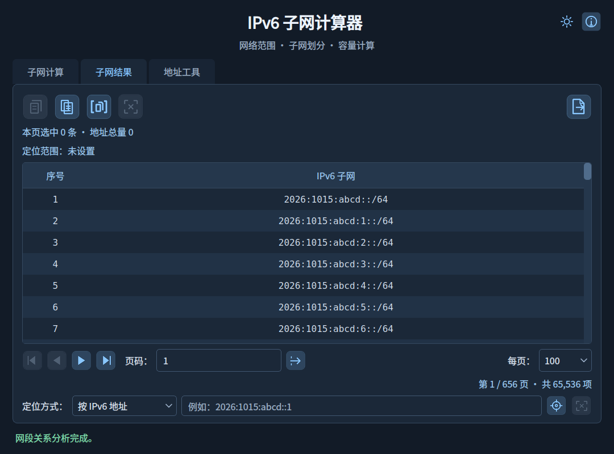
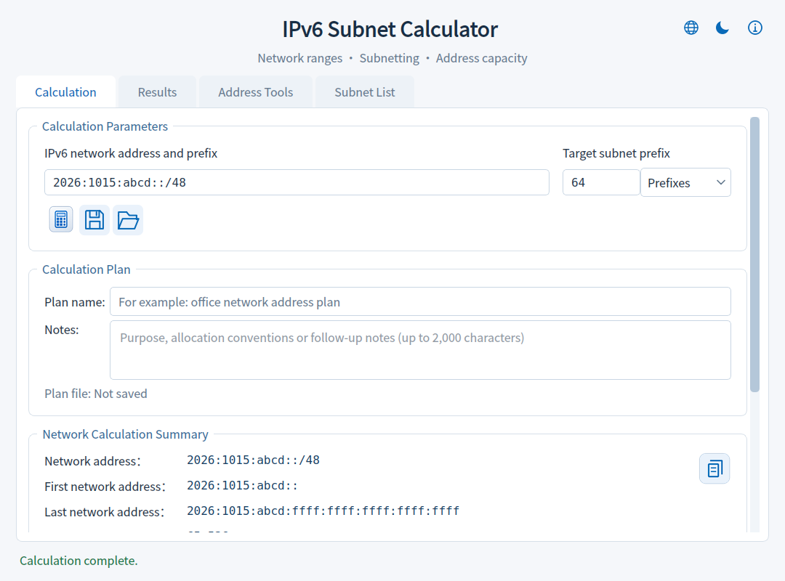
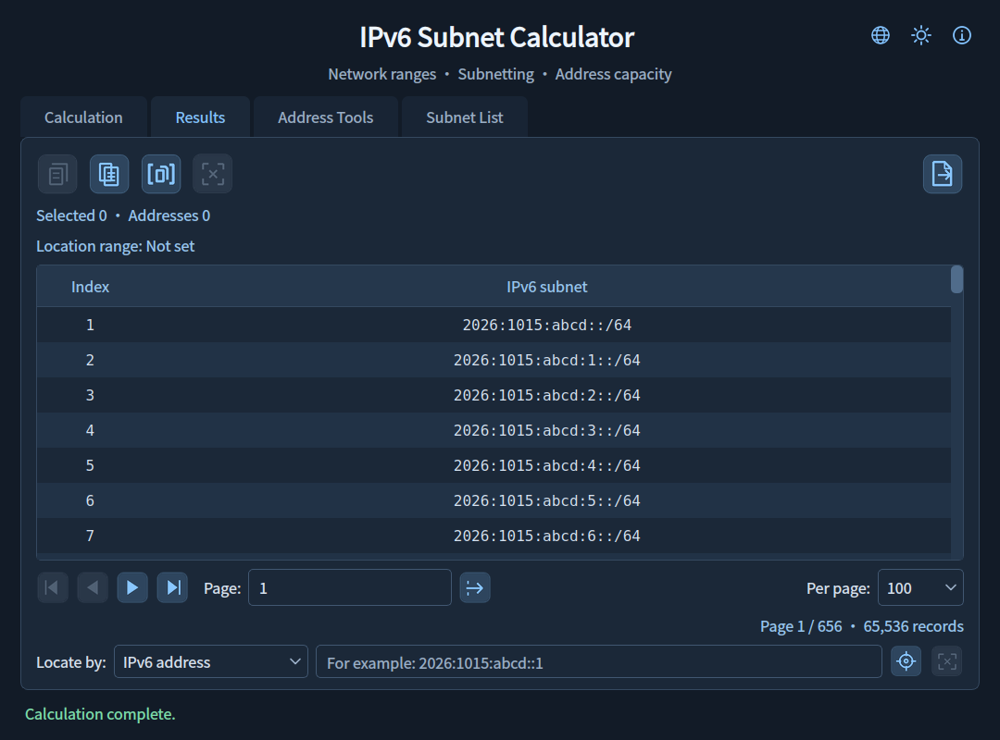
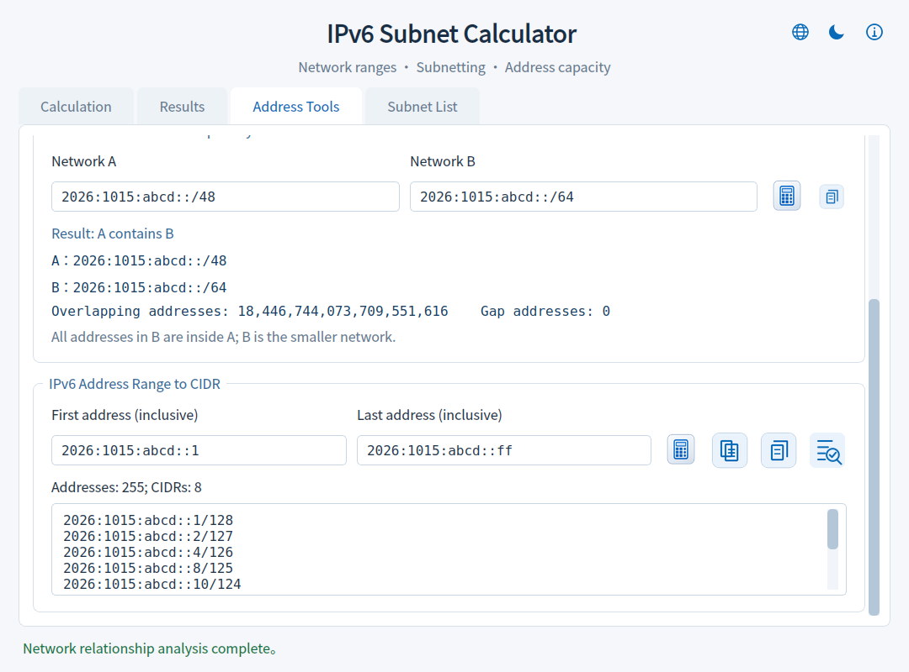
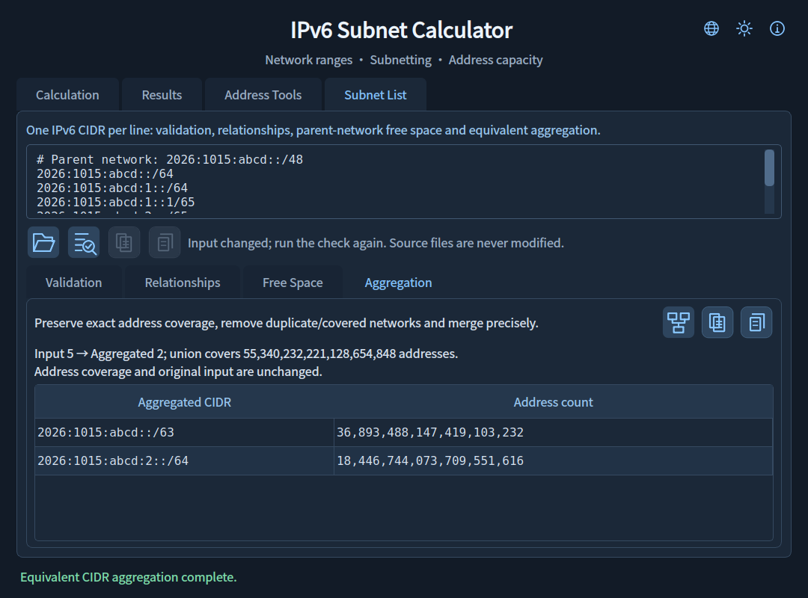

# 🌐 IPv6 子网计算器 V1.7

**简体中文** | [English](README_EN.md)

## 📖 项目简介

IPv6SubnetCalculator 是一款适用于 Windows 的离线 IPv6 子网计算工具，可分析网络范围、划分子网、识别地址用途，提供子网计算、子网结果、地址工具及子网清单四个页面，用于浏览、定位、保存子网及分析地址与网段关系。

## ✨ 主要功能

- **网络计算**：支持 `/0`～`/128` 的 IPv6 CIDR，计算网络范围、子网数量、每个子网的地址容量及新增子网位数。提供常用前缀选择、地址规范化和具体输入错误说明。
- **计算摘要复制**：点击“网络计算摘要”右上角复制图标，复制网络范围、源／目标前缀、精确容量和地址用途提示，可直接粘贴到规划文档。
- **地址用途提示**：识别 ULA、6to4、组播、链路本地等地址类型，展示用途、部署限制与规范参考；保留特殊地址的数学划分能力。
- **清晰阅读**：统一加大界面、输入框、结果表格、详情及悬停提示字体，配套调整表格行高和弹窗空间。
- **外观主题**：提供浅色和深色主题，点击右上角月亮／太阳图标切换，或按 Ctrl+Shift+T；自动记住选择。
- **四个功能页**：“子网计算”展示参数、摘要和地址用途；“子网结果”展示表格和操作工具；“地址工具”提供格式转换及双网段分析；“子网清单”检查已有 CIDR 的格式与批量关系。切换标签保留各页状态。
- **地址格式转换**：输出压缩／小写规范化、8 组完整展开和 128 位二进制，支持逐项或全部复制；接受 IPv4 映射的 IPv6 写法。
- **双网段关系分析**：输入两个 IPv6 CIDR，判断相同、A 包含 B、B 包含 A、相邻或完全独立，显示精确重叠／间隔地址数，支持复制完整报告。
- **分页与定位**：每页 25、50、100、200 条，支持页码跳转，以及按 IPv6 地址、子网序号或对应范围定位。巨大结果集仅加载当前页，范围高亮跨页保留。
- **选择统计与复制**：显示本页选中数量、首末序号、连续性和地址总量；可复制所选记录、当前页、指定序号范围及完整精确统计。支持 Ctrl/Shift 多选、Ctrl+A、Ctrl+C 和 Esc。
- **子网详情**：双击或按 Enter 查看完整地址范围、地址容量，浏览上一条、下一条并复制详情。
- **文件导出**：全部或指定范围导出为 TXT／Excel（XLSX），提供容量估算、进度与取消操作；临时文件写入完成后才替换目标文件。Excel 表头与工作表名使用开始导出时的界面语言，TXT 每行保留一个 CIDR。

## 💾 计算方案

- **保存与恢复**：将最后一次成功计算保存为本地 JSON，重新打开后自动计算并恢复每页条数、页码、定位范围、当前页选择及标签页。
- **名称与备注**：为计算方案添加名称及用途备注，方便整理不同网络的规划记录。
- **便捷操作**：计算页提供保存／打开图标及悬停提示，支持 Ctrl+S／Ctrl+O，另存为 Ctrl+Shift+S。
- **工作保护**：打开其他方案或关闭窗口前，可保存、放弃或取消未保存的参数／名称／备注更改；损坏文件不会覆盖当前结果。
- **轻量文件**：只保存参数和浏览状态，不保存海量子网列表；页码和序号使用十进制文本，保留完整精度。

## 📖 关于与离线帮助

- **关于入口**：顶部“ⓘ”图标及悬停提示，按 F1 也可打开；同一窗口重复打开时保留当前阅读位置。
- **程序信息**：查看当前程序版本、主要功能、项目许可、版权致谢及实际运行的组件版本。
- **使用说明**：内置计算、分页定位、选择复制、方案保存、地址工具、导出与快捷键说明。
- **第三方许可**：切换查看组件说明、项目 GPL／NOTICE 及 PyQt6、Qt、SIP 许可原文，离线可读。
- **法律责任**：说明用途边界、部署责任、开源权利、无担保及责任限制，与适用许可证保持一致。
- **阅读体验**：文本可选择复制，窗口可调整大小，浅深色主题同步；帮助和许可文本随 EXE 内置。

## 📋 子网清单导入与检查

- **已有网段导入**：在“子网清单”页粘贴文本，或导入 UTF-8 TXT／CIDR 文件（允许 BOM），每行一个 IPv6 CIDR；忽略空行及以 # 开头的注释。
- **逐行校验**：保留原始行号与输入，显示规范化 CIDR、主机位调整和具体错误；错误行不参与关系分析。
- **关系检查**：精确统计重复、包含及相邻关系。IPv6 CIDR 的重叠归为重复或包含；相邻不代表一定能合并。
- **规范化与报告复制**：复制有效、去重后的 CIDR（保留首次出现顺序），或复制包含错误记录、精确统计及有限关系明细的检查报告。去重不会删除被包含的子网或合并相邻网段。
- **有界处理**：每次最多 5,000 条待校验记录；文本最多 1 MiB（1,048,576 字节），含空行与注释共不超过 20,000 行；后台检查可取消。关系明细最多 1,000 对，总数仍精确统计。
- **独立工作区**：清单检查不改变计算结果或方案。清单输入、错误记录和报告不写入计算方案，需要保留时请复制保存。

## 🌐 界面语言

- **同一程序双语**：同一个 EXE 内置简体中文与 English，右上角按“语言 → 主题 → 关于”排列；点击地球图标选择语言，无需联网或重启。
- **工作状态保留**：切换语言后可继续浏览现有结果，IPv6 输入、参数、页码、选择、定位范围及规划内容保持原样。
- **完整展示范围**：页面、图标悬停、标准弹窗、错误、状态、表头及离线使用说明随语言切换；后台任务完成时使用当前语言，保存语言偏好供下次启动恢复。
- **方案通用**：同一份计算方案可在中英文界面下使用，名称、备注和原始清单内容保持原样。
- **输入提示**：支持单个 JSON 方案拖放，校验后确认替换；输入错误通过红框、警示图标和加粗说明标识。

## 🧮 空闲空间与 CIDR 整理

- **父网段空闲空间**：在“子网清单 → 空闲空间”填写父网段，把清单视作占用范围，显示占用并集、空闲地址数量及空闲 CIDR。重复和包含不会重复扣减。
- **严格规划校验**：占用清单须全部有效且完全位于父网段内，避免忽略坏数据后给出不完整规划；空清单可计算整个父网段为空闲。
- **等价 CIDR 整理**：移除重复及已被覆盖的子网，合并能够精确合并的相邻范围，得到覆盖集合完全相同的最简 CIDR。不会扩大地址覆盖，也不自动修改原始输入。
- **结果与报告**：复制完整结果或规划报告。空闲 CIDR 明细最多显示 5,000 条；若被截断，禁用完整 CIDR 复制，报告仍保留全部空闲地址范围和精确总数。
- **后台与主题**：两项任务均可取消；规划结果随输入修改失效，浅深色主题适配。顶部关于图标采用透明线条，保留悬停提示及 F1 入口。

## 📸 运行截图

截图版本：**V1.7**。

### 简体中文

### English

## 📦 下载与使用

从 GitHub [Releases](../../releases/latest) 的 Assets 中直接下载 `IPv6SubnetCalculator_V1.7.exe`，下载后即可运行，无需另行配置运行环境。输入 IPv6 网络地址与目标前缀，点击计算图标；完成后自动切换到结果页。

按 F1 或点击顶部“ⓘ”可查看内置帮助、许可原文与法律责任说明。

源码运行与构建方法见 [开发说明](docs/DEVELOPMENT.md)。

## 💡 使用说明

- “地址工具”中编辑输入会清空对应工具的旧结果，请点击图标或按 Enter 重新处理；格式转换与网段分析分别保留状态。
- 格式转换填写单个 IPv6 地址，不含 CIDR 前缀或区域标识；压缩与规范化合并显示，规范化采用小写压缩形式。二进制按 16 位分组显示，复制为连续 128 位。
- 关系分析按规范化后的 CIDR 判断；“相邻”指无重叠且首尾相接，不保证能合并为单个 CIDR。间隔地址数是两段之间未被二者覆盖的地址数量。
- 保存方案前请先完成计算；输入参数修改后需重新计算再保存。方案保存的是计算状态，地址工具及子网清单内容、主题偏好不写入方案。
- 方案名称最多 80 字，备注最多 2,000 字。翻页及选择状态随保存记录，但单独浏览不会触发关闭时的修改提示。
- 首次启动使用浅色主题；之后恢复上次选择。主题按钮悬停显示当前主题、切换目标和快捷键。
- 摘要复制对应页面上最后一次成功计算的结果；修改输入后，请重新计算以更新摘要。
- 默认示例网络为 `2026:1015:abcd::/48`。
- IPv6 没有广播地址；“结束地址”表示网段最大地址。地址总量是数学容量，不代表实际可分配主机数量。
- 手动选择仅作用于当前页，翻页或修改每页条数后清除；切换标签保留选择。范围高亮与选择分别统计。
- 修改每页条数时，以原页首子网为定位点，保留其所在位置。
- 复制指定序号范围单次最多 5,000 条；更大范围请使用文件导出。
- Excel 单工作表最多导出 1,048,575 条子网记录。导出范围含超过 15 位的序号时，整列序号以文本保存，确保数字完整。
- 巨量统计采用紧凑格式显示，悬停可查看完整值，复制统计始终保留精确整数。
- 地址类型识别不代表已获地址分配授权或公共互联网可达性。参考：[IANA IPv6 特殊用途地址登记表](https://www.iana.org/assignments/iana-ipv6-special-registry)。

## 📄 开源许可

本项目自有代码及资源采用 **GNU General Public License v3.0 或任何后续版本**（`GPL-3.0-or-later`），许可范围及声明见 [NOTICE](NOTICE)，完整条款见 [LICENSE](LICENSE)。允许使用、修改及商业分发；分发时须遵守许可证要求。本软件不提供任何担保。

第三方组件保留各自的版权与许可，不因本项目的许可声明而变更。

## 🙏 第三方组件

界面使用 PyQt6 和 Qt 6。相关版权、许可及上游链接见 [第三方组件说明](THIRD_PARTY_NOTICES.md)。
