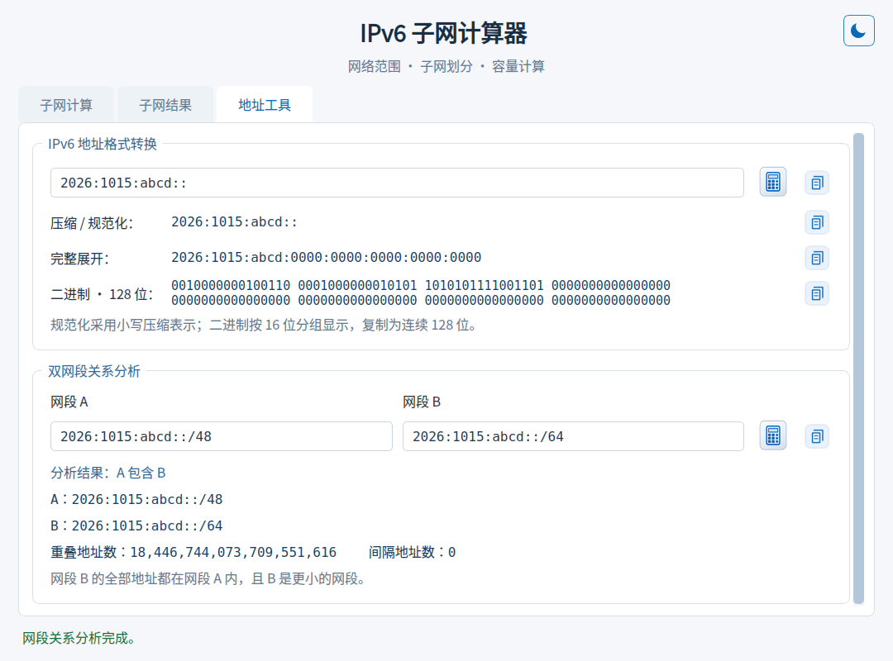
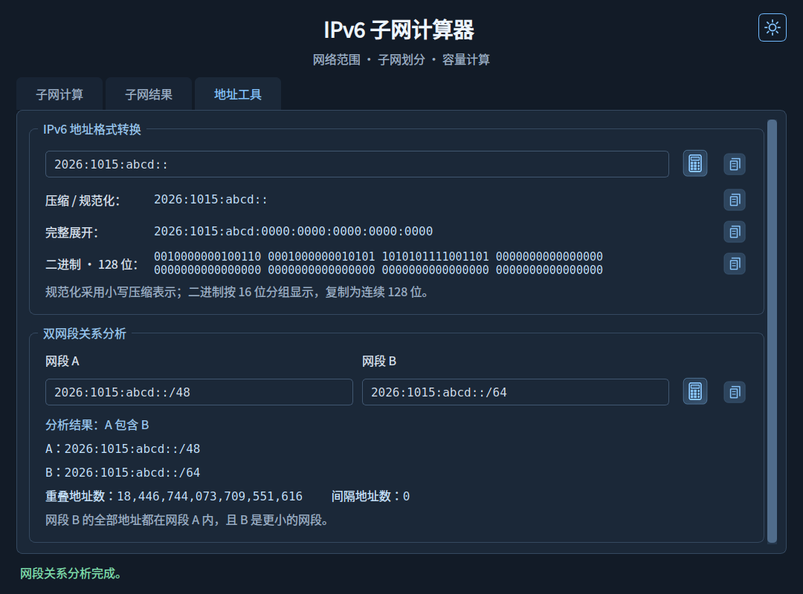

# 🌐 IPv6 子网计算器 V1.0

**简体中文** | [English](README_EN.md)

## 📖 项目简介

IPv6SubnetCalculator 是一款适用于 Windows 的离线 IPv6 子网计算工具，可分析网络范围、划分子网、识别地址用途，提供计算、结果和地址工具三个页面，用于浏览、定位、保存子网及分析地址与网段关系。

## ✨ 主要功能

- **网络计算**：支持 `/0`～`/128` 的 IPv6 CIDR，计算网络范围、子网数量、每个子网的地址容量及新增子网位数。提供常用前缀选择、地址规范化和中文输入错误说明。
- **计算摘要复制**：点击“网络计算摘要”右上角复制图标，复制网络范围、源／目标前缀、精确容量和地址用途提示，可直接粘贴到规划文档。
- **地址用途提示**：识别 ULA、6to4、组播、链路本地等地址类型，展示用途、部署限制与规范参考；保留特殊地址的数学划分能力。
- **清晰阅读**：统一加大界面、输入框、结果表格、详情及悬停提示字体，配套调整表格行高和弹窗空间。
- **外观主题**：提供浅色和深色主题，点击右上角月亮／太阳图标切换，或按 Ctrl+Shift+T；自动记住选择。
- **三个功能页**：“子网计算”展示参数、摘要和地址用途；“子网结果”展示表格和操作工具；“地址工具”提供格式转换及网段关系分析。切换标签保留各页状态。
- **地址格式转换**：输出压缩／小写规范化、8 组完整展开和 128 位二进制，支持逐项或全部复制；接受 IPv4 映射的 IPv6 写法。
- **双网段关系分析**：输入两个 IPv6 CIDR，判断相同、A 包含 B、B 包含 A、相邻或完全独立，显示精确重叠／间隔地址数，支持复制完整报告。
- **分页与定位**：每页 25、50、100、200 条，支持页码跳转，以及按 IPv6 地址、子网序号或对应范围定位。巨大结果集仅加载当前页，范围高亮跨页保留。
- **选择统计与复制**：显示本页选中数量、首末序号、连续性和地址总量；可复制所选记录、当前页、指定序号范围及完整精确统计。支持 Ctrl/Shift 多选、Ctrl+A、Ctrl+C 和 Esc。
- **子网详情**：双击或按 Enter 查看完整地址范围、地址容量，浏览上一条、下一条并复制详情。
- **文件导出**：全部或指定范围导出为 TXT／Excel（XLSX），提供容量估算、进度与取消操作；临时文件写入完成后才替换目标文件。

## 🆕 V1.0 核心功能版

- **字体与阅读体验**：常规界面文字提升至 12 pt，地址与结果使用 12 pt 等宽字体，二进制使用 11 pt；表格行高同步增加。
- **新增地址格式转换**：压缩／规范化、完整展开和二进制输出，提供逐项及全部复制。
- **新增双网段关系分析**：识别相同、包含、相邻和独立，自动规范化主机位并显示包含方向。
- **相较 V0.9 新增计算摘要复制**：一次复制完整计算结论及部署提示，数量保留完整整数；未计算或计算失败时禁用入口。

- 整合 IPv6 子网计算、地址用途提示、分页定位、选择统计、复制、详情和 TXT／Excel 导出，形成完整的核心使用流程。
- 提供统一的 PyQt6 三标签页界面、浅色／深色主题及图标悬停提示，自动保存主题选择。
- 提供独立运行的 Windows 程序包，包含程序及项目／第三方许可文件。

### 🐛 异常与错误处理

- 无效网络、前缀、序号及范围提供明确提示。
- 导出线程无法启动或异常结束时恢复操作，允许重试。
- 导出失败或取消时保留已有目标文件，并清理未完成的临时文件。

## 📸 运行截图

### 浅色主题

### 深色主题

## 📦 下载与使用

从 GitHub [Releases](../../releases) 下载 `IPv6SubnetCalculator_V1.0_Windows.zip`，解压后运行其中的 `IPv6SubnetCalculator_V1.0.exe`，无需安装 Python。输入 IPv6 网络地址与目标前缀，点击计算图标；完成后自动切换到结果页。

源码运行与构建方法见 [开发说明](docs/DEVELOPMENT.md)。

## 💡 使用说明

- “地址工具”中编辑输入会清空对应工具的旧结果，请点击图标或按 Enter 重新处理；格式转换与网段分析分别保留状态。
- 格式转换填写单个 IPv6 地址，不含 CIDR 前缀或区域标识；压缩与规范化合并显示，规范化采用小写压缩形式。二进制按 16 位分组显示，复制为连续 128 位。
- 关系分析按规范化后的 CIDR 判断；“相邻”指无重叠且首尾相接，不保证能合并为单个 CIDR。间隔地址数是两段之间未被二者覆盖的地址数量。
- 首次启动使用浅色主题；之后恢复上次选择。主题按钮悬停显示当前主题、切换目标和快捷键。系统文件选择器与标题栏的外观由操作系统决定。
- 摘要复制对应页面上最后一次成功计算的结果；修改输入后，请重新计算以更新摘要。
- 默认示例网络为 `2026:1015:abcd::/48`。
- IPv6 没有广播地址；“结束地址”表示网段最大地址。地址总量是数学容量，不代表实际可分配主机数量。
- 手动选择仅作用于当前页，翻页或修改每页条数后清除；切换标签保留选择。范围高亮与选择分别统计。
- 修改每页条数时，以原页首子网为定位点，保留其所在位置。
- 复制指定序号范围单次最多 5,000 条；更大范围请使用文件导出。
- Excel 单工作表最多导出 1,048,575 条子网记录。导出范围含超过 15 位的序号时，整列序号以文本保存，确保数字完整。
- 巨量统计采用紧凑格式显示，悬停可查看完整值，复制统计始终保留精确整数。
- 地址类型识别不代表已获地址分配授权或公共互联网可达性。参考：[IANA IPv6 特殊用途地址登记表](https://www.iana.org/assignments/iana-ipv6-special-registry)。

## 📄 开源许可

本项目自有代码及资源采用 **GNU General Public License v3.0 或任何后续版本**（`GPL-3.0-or-later`），许可范围及声明见 [NOTICE](NOTICE)，完整条款见 [LICENSE](LICENSE)。允许使用、修改及商业分发；分发时须遵守许可证要求。本软件不提供任何担保。

第三方组件保留各自的版权与许可，不因本项目的许可声明而变更。

## 🙏 第三方组件

界面使用 PyQt6 和 Qt 6。相关版权、许可及上游链接见 [第三方组件说明](THIRD_PARTY_NOTICES.md)。
