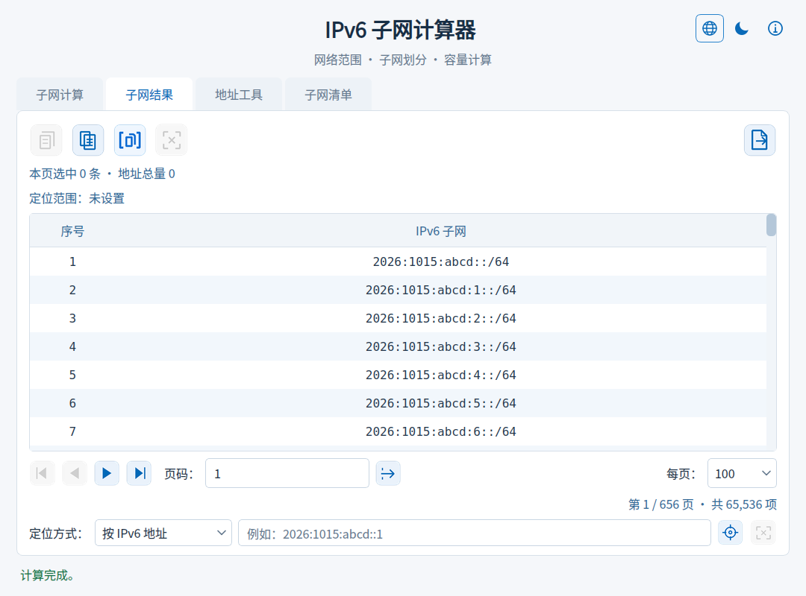
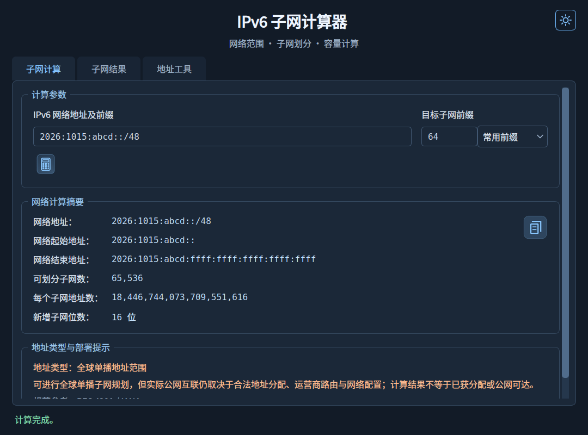

# 🌐 IPv6 Subnet Calculator V0.9

[简体中文](README.md) | **English**

## 📖 Overview

IPv6SubnetCalculator is an offline IPv6 subnet calculator for Windows. It analyzes network ranges, divides subnets, identifies address usage, and provides two tabs for browsing, locating, and saving large result sets.

## ✨ Features

- **Network calculations:** IPv6 CIDR `/0`–`/128`, network ranges, subnet counts, addresses per subnet, and additional subnet bits. Includes common prefix shortcuts, address normalization, and Chinese input validation messages.
- **Address guidance:** Classifies ULA, 6to4, multicast, link-local, and other address types, with usage, deployment limitations, and standards references. Mathematical subnetting remains available for special-purpose addresses.
- **Appearance:** Light and dark themes, switched with the moon/sun icon at the top right or Ctrl+Shift+T. Your preference is remembered.
- **Two-tab layout:** Calculation contains inputs, summaries, and usage guidance; Results contains the table and actions. Switching tabs preserves the current state.
- **Pagination and location:** 25, 50, 100, or 200 rows per page; page navigation and lookup by IPv6 address, subnet index, or corresponding ranges. Only the current page is loaded, and locator highlighting persists across pages.
- **Selection and copying:** Current-page counts, first and last indices, continuity, and total address capacity. Copy selected subnets, the current page, an index range, or exact statistics. Supports Ctrl/Shift selection, Ctrl+A, Ctrl+C, and Esc.
- **Subnet details:** Double-click or press Enter to inspect full address ranges and capacity, browse adjacent subnets, and copy details.
- **File export:** Export all subnets or a range to TXT or Excel (XLSX), with size estimates, progress, and cancellation. The destination is replaced only after its temporary file is written successfully.

## 🆕 What's New in V0.9

- Improved export recovery: if the worker cannot start, the progress dialog closes, controls are restored, and the export can be retried.
- Added a clear error message when an export worker ends without returning a result.
- Unified IPv6 network and prefix validation across calculation, location, pagination, range copying, and export entry points; invalid indices and estimate ranges are rejected.
- Invalid export parameters are rejected before temporary-file creation, preserving existing destination files.

## 📸 Screenshots

### Light Theme

### Dark Theme

## 📦 Download and Usage

Get the Windows application from GitHub [Releases](../../releases), extract it, and run it. Enter an IPv6 network and target prefix, then click Calculate. The application switches to Results when calculation completes.

For running from source and building, see [Development Notes](docs/DEVELOPMENT.md).

## 💡 Notes

- The first launch uses the light theme; subsequent launches restore your choice. Hover over the theme icon to see the current theme, next theme, and shortcut. Native file pickers and title bars follow the operating system.

- The default example network is `2026:1015:abcd::/48`.
- IPv6 has no broadcast address; the end address is the last address in the network. Address capacity is a mathematical total, not an assignable host count.
- Manual selection applies only to the current page and clears on page or page-size changes. Switching tabs preserves selection. Locator highlighting is counted separately.
- Changing page size uses the original page's first subnet as the navigation anchor.
- Index-range copying supports up to 5,000 records per operation; use file export for larger ranges.
- One Excel worksheet supports up to 1,048,575 subnet records. If the export includes indices longer than 15 digits, the entire index column is stored as text to preserve every digit.
- Very large statistics use compact display formatting. Hover for full values; copied statistics always contain exact integers.
- Address classification does not imply allocation authorization or public reachability. See the [IANA IPv6 Special-Purpose Address Registry](https://www.iana.org/assignments/iana-ipv6-special-registry).

## 📄 License

Project-authored code and assets are licensed under the **GNU General Public License v3.0 or any later version** (`GPL-3.0-or-later`). See [NOTICE](NOTICE) for the scope and notice, and [LICENSE](LICENSE) for the full terms. Use, modification, and commercial redistribution are permitted subject to the license. This software comes without any warranty.

Third-party components retain their own copyrights and licenses; this project's license declaration does not change them.

## 🙏 Third-Party Components

The interface uses PyQt6 and Qt 6. Copyright, license information, and upstream links are listed in [Third-Party Notices](THIRD_PARTY_NOTICES.md).
